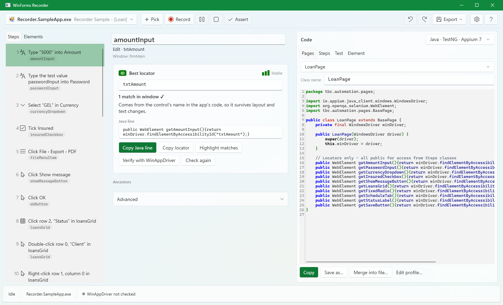
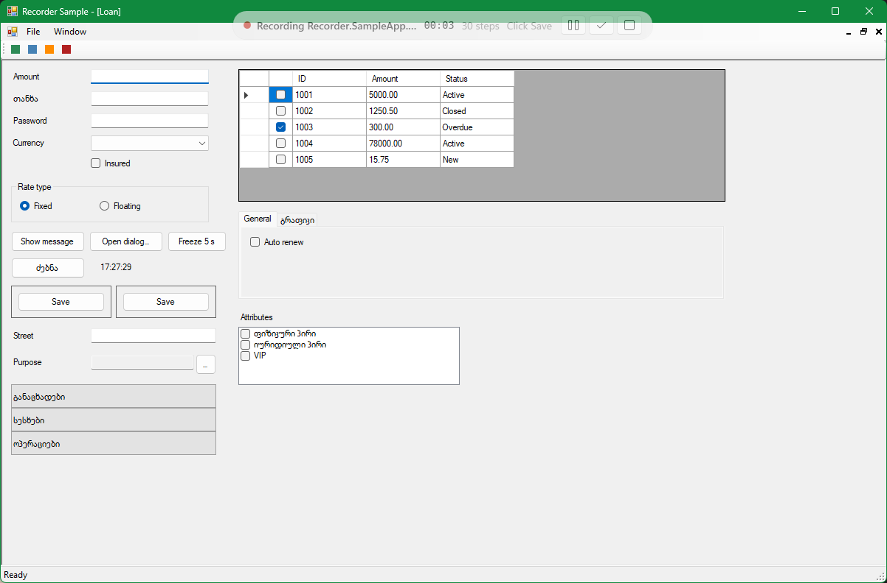
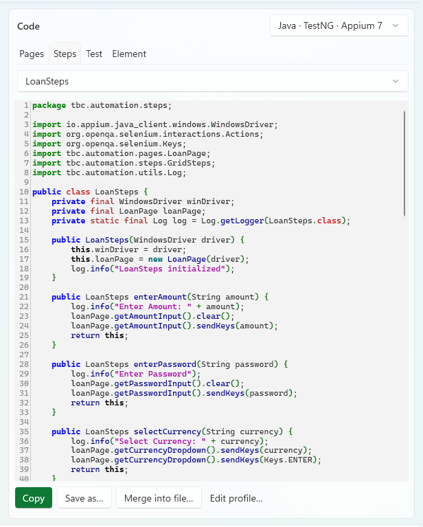

# WinForms Recorder

WinForms Recorder is a locator inspector and test recorder for .NET Framework WinForms apps automated with WinAppDriver.

- Hover a control and press one hotkey. You get the most stable locator, whether it is unique, and a ready-to-paste Java line.
- Record a flow. You get Page, Steps and Test classes in the style of your own Java framework.

It replaces Microsoft's WinAppDriver UI Recorder, kept unmodified in [legacy/UIRecorder](legacy/UIRecorder). Everything
stays on your PC: no telemetry, no update checks, and password fields are never read.

<!-- The screenshots show the published exe and the SampleApp, in the light theme. Take them from the SampleApp only,
     never from LMS: its windows show customer names and client numbers. -->


## Quick start

1. **Start it.** Copy `WinFormsRecorder.exe` to any folder and run it: no installation, no admin rights, no .NET needed.
2. **Choose the app.** Start the app you automate, click **Choose app** and pick its window.
3. **Capture or record.** Hover a control and press **Ctrl+Shift+X**: the Inspector shows its best locator, whether it is
   unique, and the Java line to paste. Or press **F9**, use the app as usual and press **F9** again: the code pane shows
   the Page, Steps and Test classes for what you did.





**F1** lists every shortcut. The [user guide](docs/USER_GUIDE.md) explains the rest on one page, and
[docs/TEMPLATES.md](docs/TEMPLATES.md) how to change the generated code.

The exe is built from this repository with `./build.ps1 publish` (below), which writes
`artifacts\publish\win-x64\WinFormsRecorder.exe`.

**Status.** Version 0.7.1: all six phases of the spec are done. LMS's controls were checked on 2026-11-04: its editors are
text boxes and its grids DataGridViews, which the recorder handles. Still to be checked: recording LMS's date and
check-combo pop-ups, and two monitors at different scales. Known problem: at 150 % display scaling, grid cells and other
parts without their own window are outlined in the wrong place ([docs/HANDOFF.md](docs/HANDOFF.md)).

## Build from source

**Requirements**

- Windows 10/11 or Windows Server 2022, x64.
- No admin rights needed.
- .NET SDK **10.0.403**; see [global.json](global.json). A per-user install is fine.
- A NuGet feed. [NuGet.config](NuGet.config) points only at the corporate Nexus group, because api.nuget.org is
  blocked on the corporate network. Anywhere else, set `WINFORMSRECORDER_NUGET_SOURCE` to
  `https://api.nuget.org/v3/index.json` once for your user (see [docs/HANDOFF.md](docs/HANDOFF.md)).

**Install the SDK per user** if `dotnet --list-sdks` does not show 10.0.x. Compare the hash with the
`sha512` of `dotnet-sdk-win-x64.zip` in the
[release metadata](https://dotnetcli.blob.core.windows.net/dotnet/release-metadata/10.0/releases.json):

```powershell
$v = '10.0.403'
curl.exe -L -o "$env:TEMP\dotnet-sdk.zip" "https://dotnetcli.blob.core.windows.net/dotnet/Sdk/$v/dotnet-sdk-$v-win-x64.zip"
(Get-FileHash -Algorithm SHA512 "$env:TEMP\dotnet-sdk.zip").Hash
New-Item -ItemType Directory -Force "$env:LOCALAPPDATA\Microsoft\dotnet" | Out-Null
tar -xf "$env:TEMP\dotnet-sdk.zip" -C "$env:LOCALAPPDATA\Microsoft\dotnet"
```

**Build, test, run, publish.** [build.ps1](build.ps1) finds the SDK and opts out of dotnet CLI telemetry.

```powershell
./build.ps1          # build; src/ treats every warning as an error
./build.ps1 test     # unit + integration tests; integration tests open the sample app and the recorder briefly
./build.ps1 run      # start WinForms Recorder
./build.ps1 publish  # the self-contained exe: artifacts\publish\win-x64\WinFormsRecorder.exe
```

`./build.ps1 publish` takes about 2.5 minutes and makes one 77 MB exe for Windows 10/11 x64 with .NET and WPF inside, so it
runs where .NET isn't installed. The first publish downloads the .NET runtime packs (86 MB) into the NuGet cache. On its
first start the exe unpacks WPF's native DLLs (8 MB) to `%TEMP%\.net\WinFormsRecorder`; where a company blocks programs in
`%TEMP%`, set the environment variable `DOTNET_BUNDLE_EXTRACT_BASE_DIR` to an allowed folder. To run the integration tests
against the published exe instead of the build output:

```powershell
./build.ps1 test -Published
```

Some integration tests use the real mouse and keyboard. `./build.ps1 test` runs them first, for about a minute and a half
(they put the cursor back, type into the SampleApp, use the Save dialog, and one borrows the clipboard and restores its text).
While they run, the session must be unlocked and the remote-desktop window not minimized; don't touch the mouse or keyboard.
Leave them out while you work:

```powershell
./build.ps1 test -NoInput
```

The tests marked `[Trait("Requires", "WinAppDriver")]` compare every generated locator with a real WinAppDriver. They are
skipped unless WinAppDriver answers at the given address (default `http://127.0.0.1:4723`) and add about 10 minutes after
the mouse tests. Meanwhile WinAppDriver keeps a **Recorder Sample** window in front: you can use other windows, but leave
that one open and don't click it, or the run fails:

```powershell
./build.ps1 test -WinAppDriverUrl http://127.0.0.1:4727
```

With two monitors, `WindowPlacementTests` close the recorder on each one and check that it opens there again (with one
monitor they are skipped), and `-Monitor 2` runs the tests with the SampleApp on the second monitor (1 is the main display,
the others follow from left to right). Spec 14 asks for one run per monitor, with one of them at 150 %:

```powershell
./build.ps1 test -Monitor 2
```

The tests marked `[Trait("Requires", "JDK")]` compile the generated Java with javac against the real Appium java-client
7.6.0 jars. They are skipped without a JDK 17 or the jars; see [tests/JavaCompileCheck/README.md](tests/JavaCompileCheck/README.md).

## Where things live

| Path | What |
|---|---|
| `src/Recorder.Core` | All logic, no WPF |
| `src/Recorder.App` | WPF app (`WinFormsRecorder.exe`); the publish profile is `Properties/PublishProfiles/win-x64.pubxml` |
| `src/Recorder.Profiles` | The built-in code profiles: `profile.json` and Scriban templates |
| `tests/` | Unit tests, FlaUI integration tests, `Recorder.SampleApp` (a .NET Framework 4.8 app imitating LMS) and `JavaCompileCheck` |
| `docs/USER_GUIDE.md` | Using the recorder, on one page |
| `docs/TEMPLATES.md` | How to change the generated code: profiles, the template model, examples |
| `docs/ARCHITECTURE.md` | Design, legacy → new mapping, decisions and **Findings** (verified UIA facts) |
| `docs/HANDOFF.md` | Where the work stands, what is still open, and how to set up another PC |
| `docs/SPEC.txt` | The original specification, verbatim |
| `AGENTS.md` | Rules and commands for AI coding assistants |
| `docs/target-style/` | Real Page/Steps/Test files the generated Java must match |
| `eng/list-licenses.ps1` | License inventory for [THIRD_PARTY_NOTICES.md](THIRD_PARTY_NOTICES.md) |
| `artifacts/publish/win-x64/` | The published exe (not in git) |

## Privacy

- No telemetry, update checks or crash reporters. Tests enforce this, including transitive packages.
- Logs stay on this machine: `%LOCALAPPDATA%\WinFormsRecorder\logs`, kept for 7 days. "Detailed logs" adds timings and
  statuses, never names, values or titles.
- Password fields are never read, and printable keystrokes are never recorded: only Enter, Tab, Esc, F1–F12, Delete, the arrows
  and Ctrl or Alt shortcuts, and in a password field only Enter and Tab.
- Recordings never store element values or window titles; logs never hold typed values. A dialog without an AutomationId
  is kept as "Window 1", "Window 2"… in the file, and its controls find it again when you capture them after opening.
- Generated code never names a class, variable or log line after a window title, and never contains a password.

## License notices

Third-party components and their licenses are listed in [THIRD_PARTY_NOTICES.md](THIRD_PARTY_NOTICES.md). The published
exe contains the .NET runtime and the packages listed there as shipped: when you hand the exe to someone, hand them that
file too.
